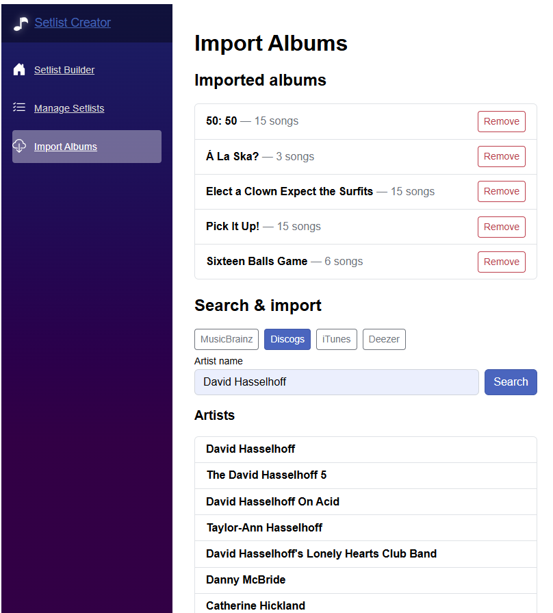
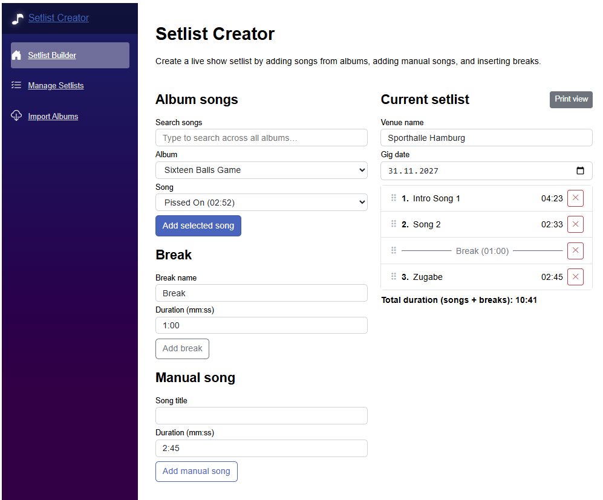
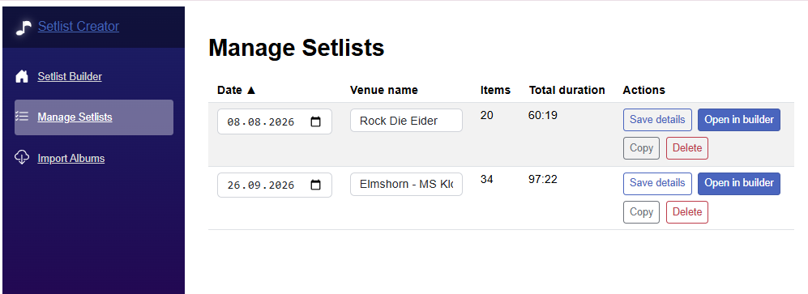
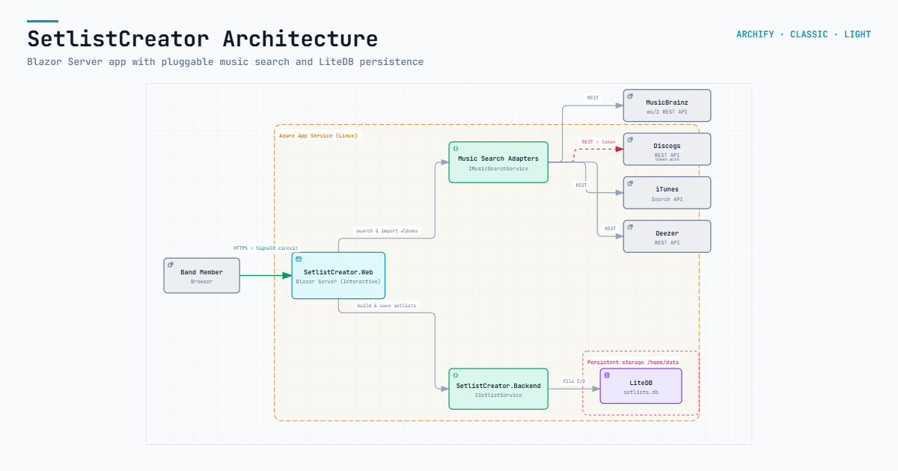

# SetlistCreator Features

Vibe-coded tool to select songs for my band setlist.

**Features:**
- Create and manage multiple setlists (list of songs for a musical performance)
- Import songs from published albums (using Spotify, Deezer, etc. as data source) so that verified song titles and song durations can be used.
- Ability to add breaks and custom (non-imported) songs to your setlist
- Print-layout tailored to on-stage setlists (automatically scaled for best readability)
- ready-to go script to host the full application incl. data persistence on azure

The album song titles and song durations can be imported from a music service like Deezer, Discogs or Apple Music so that you don't have to enter them manually.

Setlist creation is simplified with an intuitive interface that allows you add songs into your own setlist, automatically calculate total duration, and manage multiple setlists efficiently.
Custom songs and breaks (those that not imported from music services) can be added manually to the setlist.

The setlist then can be printed in an optimized 1-Page layout to be easily readable when lying on the stage floor.

## Screenshots

## Projects

- `src/SetlistCreator.Backend`: C# domain and setlist management service
- `src/SetlistCreator.Web`: Blazor frontend for creating setlists
- `tests/SetlistCreator.Backend.Tests`: Unit tests for backend behavior

Setlists are persisted with LiteDB and can be managed from the `/setlists` page (update venue/date, copy, delete).

## Configuration

- `Discogs:Token`: Optional Discogs API token. In Azure App Service, set it as `Discogs__Token`.
- `Setlist:DatabasePath`: Optional LiteDB file path. Leave it empty locally to use the default app path. In Azure App Service, set it to the mounted persistent storage path such as `/home/data/setlists.db`.

## Azure

Use [scripts/azure-appservice-linux-init.ps1](scripts/azure-appservice-linux-init.ps1) for one-time Linux App Service provisioning and Azure resource setup.

Use [scripts/azure-appservice-linux-deploy.ps1](scripts/azure-appservice-linux-deploy.ps1) for repeatable application publish and deployment.

Use [scripts/azure-appservice-linux.ps1](scripts/azure-appservice-linux.ps1) as a compatibility wrapper when you want to run both steps together.

Before deploying to Azure, confirm the target App Service runtime supports the current framework in `src/SetlistCreator.Web/SetlistCreator.Web.csproj`.
